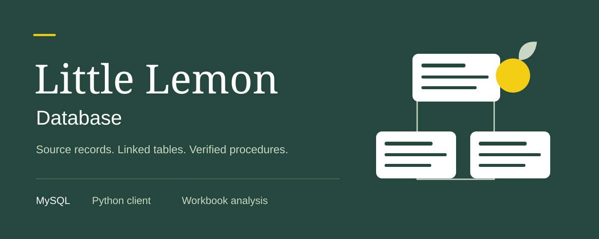
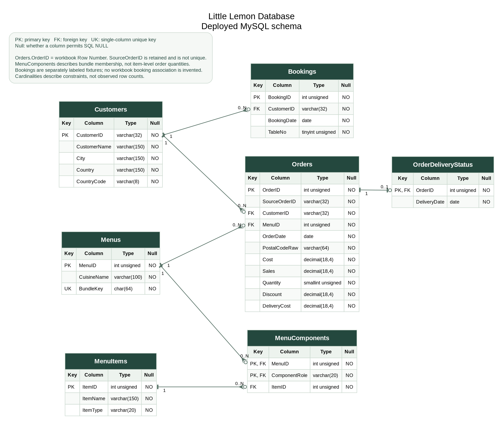

# Little Lemon — Workbook-backed database and booking procedures

Import the supplied restaurant workbook into a linked MySQL model, inspect its data quality, and manage bookings through five tested stored procedures.

The project preserves all **21,000 workbook rows**, documents repeated source identifiers, and exports analysis data at a verified record grain. Four explicitly labeled booking fixtures exercise the booking procedures because the workbook supplies no booking records.

[Run the project](#-quick-start) · [View the ER diagram](diagrams/little_lemon_er_diagram.pdf) · [Read the notebook](notebooks/Little_Lemon_Database.ipynb) · [Review the rubric](COURSERA_RUBRIC_CHECKLIST.md)

##  Features

- Seven linked tables, deployed in the dedicated `little_lemon_database` schema.
- `GetMaxQuantity`, `ManageBooking`, `UpdateBooking`, `AddBooking`, and `CancelBooking`, invoked through MySQL Connector/Python.
- Transactional imports that preserve unrelated records and reject conflicting identities instead of overwriting them.
- ER PNG/PDF exports generated from the actual database metadata, with an exact alignment check.
- A completed notebook and reconciled Tableau-ready CSV files, with native-tool limits stated plainly.

### Actual workbook and deliberate modeling choices

The unchanged source is [data/source/LittleLemon_data.xlsx](data/source/LittleLemon_data.xlsx). See [the workbook audit](data/WORKBOOK_AUDIT.md) for sheets, every column, storage types, missing values, transformations, source hashes, and quality findings.

There are **1,000 source Order IDs repeated across 21,000 differing rows**. `Orders.OrderID` therefore uses the unique source Row Number, while `SourceOrderID` preserves the original identifier. No rows are discarded as supposed duplicates. Sales measures retain four decimal places to preserve genuine half cents. The workbook does not establish currency or Discount meaning; no currency, refund treatment, or profit is invented.

There are **9,366 delivery-before-order records** and invalid-looking postal values. They are preserved and flagged, not silently corrected. Menu components describe bundle membership; the workbook does not provide component prices/quantities, so an invented order-items table would misstate its grain. No staff table or booking-to-order assignment is fabricated.

This is separate from the [Django capstone](https://github.com/yaqyn/little-lemon-django-capstone) and [sales report](https://github.com/yaqyn/little-lemon-sales-report). Their code, configuration, datasets and Git histories are not changed by this project. Pool cleanup and transaction patterns were adapted from the sales report; its fictional dataset and different procedure signatures were not substituted for the supplied workbook.

##  Installation

Requires Python 3.14, MySQL 8.0.29+ (tested with 8.4), and Graphviz `dot` to regenerate the ER exports. PDF preview verification also uses Poppler (`pdftoppm`, `pdfinfo`). On Debian/Ubuntu, the system packages are `graphviz poppler-utils`; use equivalent packages on other platforms.

From the parent of the extracted project:

```bash
cd Little-Lemon-Database
python3.14 -m venv .venv
source .venv/bin/activate
python -m pip install -r requirements.txt
cp .env.example .env
```

For the exact tested dependency set, use `requirements.lock.txt`. Set your private `MYSQL_HOST`, `MYSQL_PORT`, `MYSQL_USER`, `MYSQL_PASSWORD` and `MYSQL_DATABASE=little_lemon_database`. A different database name is refused by the client. Never commit `.env`.

### Reuse an existing MySQL server safely

The existing Little Lemon MySQL service may be reused on `127.0.0.1:3306` without editing either existing project's Compose file, environment or tables. In an administrator session, create a **new account** scoped only to this assignment schema, substituting a private password locally:

```sql
CREATE USER 'little_lemon_database_app'@'%' IDENTIFIED BY 'replace-with-your-local-password';
GRANT ALL PRIVILEGES ON little_lemon_database.* TO 'little_lemon_database_app'@'%';
```

Restrict the host more tightly where your installation allows. Account provisioning is a server-administration prerequisite; all assignment operations use pooled Connector/Python connections. The application can then create the dedicated database itself. Do not reset an existing account or grant this application access to the other schemas.

### Optional independent server

For an independent Docker service, set `MYSQL_PORT=3308` and a separate `MYSQL_ROOT_PASSWORD` in this project's `.env`, then:

```bash
docker compose up -d --wait db
```

This Compose service has its own volume and loopback port. `docker compose down` stops it while retaining data; `down -v` deletes that standalone volume and should be used only intentionally. The delivered integration tests used the existing MySQL 8.4 server; the optional Compose configuration is supplied independently.

##  Quick start

```bash
python python/verify_database.py --setup
python scripts/generate_er.py
python python/run_procedures.py
python python/tableau_export.py
python -m unittest discover -v
```

Setup creates missing tables, imports actual workbook data, adds missing booking fixtures, creates missing routines and validates the database. Expect `GetMaxQuantity` to return **3**. The procedure demo reports booked/available tables, commits a new booking, updates it, cancels it, and checks missing-booking errors. It cleans up its own temporary record and leaves the four fixtures intact.

To inspect the completed notebook interactively:

```bash
jupyter notebook notebooks/Little_Lemon_Database.ipynb
```

Run all cells in order; stop the Jupyter server with Ctrl+C. To execute with a real kernel and save fresh outputs:

```bash
python scripts/execute_notebook.py
```

##  Stored procedure reference

These are database routines, not Django API endpoints. No detailed original lab-signature sheet was present; the following interface implements the supplied assignment baseline explicitly. Customer IDs are strings because that is their actual workbook format.

| Procedure | Arguments, in order | Behavior |
| --- | --- | --- |
| `GetMaxQuantity()` | None | Maximum `Orders.Quantity` from the imported workbook |
| `ManageBooking(date, table)` | DATE, INT | Availability message and `IsBooked`; does not change records |
| `UpdateBooking(id, date)` | INT, DATE | Locks and updates an existing booking; missing IDs error |
| `AddBooking(id, customer, date, table)` | INT, VARCHAR(32), DATE, INT | Validated insert; rejects duplicate IDs/date-table pairs and unknown customers |
| `CancelBooking(id)` | INT | Locks and removes an existing booking; missing IDs error |

Bookings use one reservation per date/table, with table numbers 1–50. Historical dates are permitted for course-era examples. The [four fixtures](data/BOOKING_FIXTURES.md) are demonstration bookings, not workbook records. No direct relationship between a source order and a booking is assumed.

```python
from python.database import create_pool, call_procedure

pool = create_pool()
call_procedure(pool, "GetMaxQuantity")
call_procedure(pool, "ManageBooking", ("2022-10-10", 1))
```

Mutating calls require `commit=True` to persist. Procedures do not secretly commit internally. Omitting the commit rolls back changes when the context returns the connection. For the direct `cursor.callproc()`/`stored_results()` pattern and explicit `connection.commit()`, see the executed notebook. The pinned connector still supports `stored_results()`, although its current release marks it deprecated.

##  Model and data flow



The [full-size PDF](diagrams/little_lemon_er_diagram.pdf), [SVG](diagrams/little_lemon_er_diagram.svg), [SQL schema](sql/schema.sql), and [metadata manifest](diagrams/schema_manifest.json) describe the same seven tables. `MenuComponents` has a composite FK that pairs `ItemID/ComponentRole` with `MenuItems.ItemID/ItemType`, so a component cannot reference an item of the wrong role.

`python/database.py` owns configuration, pool cleanup, DDL and routine invocation. `python/import_workbook.py` reads source XML directly to preserve numeric text before Decimal normalization. `python/verify_database.py` reconciles the deployment, while `python/tableau_export.py` creates analysis extracts. The notebook demonstrates these operations with actual saved output.

Every cursor and acquired connection is closed in nested `finally` blocks. `connection.close()` returns a pooled checkout; reusable physical sockets remain until the process/kernel ends. Uncommitted work is rolled back, including SQL/Python error paths. MySQL DDL implicitly commits, so schema creation is non-destructive and resumable, while workbook inserts use a separate atomic transaction. Existing table/routine definitions are never dropped on rerun.

### Tableau and Workbench

[Tableau instructions and field mappings](tableau/README.md) explain the verified exports, expected totals and dashboard steps. The one-row-per-source-record fact extract avoids the fivefold sales fan-out that a raw MenuComponents join would cause. Booking data is a separate, clearly labeled source.

**Tableau Desktop and MySQL Workbench native execution are NOT VERIFIED.** No fake `.twbx` or `.mwb` is included. Genuine SQL deployment, ER PNG/PDF files, CSV exports, and native-tool reproduction steps are supplied. See [diagrams/README.md](diagrams/README.md) for Workbench reverse-engineering steps.

##  Verification and submission

[COURSERA_RUBRIC_CHECKLIST.md](COURSERA_RUBRIC_CHECKLIST.md) records each of the eight supplied grading criteria with executed evidence. [evidence/verification.json](evidence/verification.json) records runtime versions, test results, source counts and limitations. Tests use only the dedicated assignment database and temporary test bookings; they do not reset the source fixtures.

The submission package is `Little_Lemon_Database.zip`, containing this complete `Little-Lemon-Database` folder. Use the repository URL for the GitHub field and the ZIP for file upload where requested. The deadline supplied with the brief is November 16 at 23:59 UTC+03:00. No online peer-grade submission or hidden-grader outcome is claimed.

##  Limits and private configuration

Passwords, `.env`, virtual environments, notebook kernels and caches are excluded from Git and the ZIP. Source files for both existing projects are kept read-only. The new account is granted privileges only on `little_lemon_database.*`; the Python client also rejects either older database name.

The workbook is the supplied course input, not a verified real-business ledger. Its repeated identifiers, unknown currency/Discount semantics and anomalous dates limit what can be inferred. Source values remain available for review; no missing employee records, per-item prices, valid postal codes or booking associations are invented.

> Learning project: Little Lemon database assignment. The supplied workbook provides the analytical records; separately labeled booking fixtures demonstrate the required routines. Implementation and verification are maintained by Abdulrahman M. Yaqyn.
